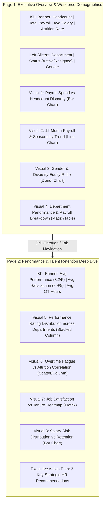

# 🚀 Enterprise HR & Performance Analytics Dashboard — Upgrade Blueprint
> **Portfolio-Grade Upgrade for LinkedIn & GitHub Showcase**  
> **Author:** Data & People Analytics Specialist  
> **Dataset:** 500 Employees | 5,097 Payroll Records | Star Schema Architecture

---

## 🎨 ၁။ Theme & Color Palette (Light Blue & Crisp White)

ဤ Dashboard သည် နိုင်ငံတကာ ထိပ်တန်း Fortune 500 ကုမ္ပဏီများနှင့် Top LinkedIn Data Analysts များ အသုံးပြုသည့် **Executive Modern Clean (Light Theme)** ပုံစံဖြင့် တည်ဆောက်ထားပါသည်:

| အစိတ်အပိုင်း (Component) | အရောင်ကုဒ် (Hex Code) | အသုံးပြုပုံ (Usage) |
|---|---|---|
| **Canvas Background** | `#FFFFFF` / `#F8FAFC` | မျက်စိအေးပြီး သန့်ရှင်းသော အဖြူရောင် အောက်ခံ |
| **Containers & Cards** | `#EBF3FA` (Soft Light Blue) | Visual များနှင့် KPI Cards များအတွက် အပြာနုရောင် အကွက်များ |
| **Card / Visual Borders** | `#93C5FD` / `#BFDBFE` | နူးညံ့ပြီး ရှင်းလင်းသော အပြာနုရောင် အနားသတ်များ (Border Radius: 8px) |
| **Primary Text & Headings**| `#0F172A` (Slate Dark Navy) | မြင်သာထင်ရှားသော စာလုံးအရောင် (High Contrast) |
| **Supporting Subtitles** | `#475569` / `#334155` | ရှင်းလင်းချက် စာတန်းငယ်များ |
| **Accent / Header Blue** | `#1E40AF` / `#2563EB` | Table Header နှင့် Chart Highlight အပြာရင့်ရောင် |
| **Negative Alert (Risk)** | `#E11D48` (Coral Red) | Attrition Rate နှင့် Overtime Burnout သတိပေးချက်များ |
| **Positive / Target** | `#10B981` (Emerald Green) | Active Retention နှင့် Performance ပန်းတိုင်များ |

---

## 📑 ၂။ Multi-Page Narrative Dashboard Structure (LinkedIn & GitHub Form)

LinkedIn နှင့် GitHub တွင် Recruiter များနှင့် Data Leaders များကို အထင်ကြီးစေမည့် Dashboard များသည် **Single Page** မဟုတ်ဘဲ **2-Page Strategic Story** ဖြင့် ဖွဲ့စည်းထားလေ့ရှိပါသည်:



---

## 🧮 ၃။ Top 10 Core DAX Measures (Copy & Paste Ready)

Power BI ထဲတွင် `_Measures` Table သီးသန့်ဆောက်ပြီး အောက်ပါ ဖော်မြူလာများကို အသုံးပြုပါ:

```dax
// 1. Total Headcount
Total Headcount = COUNTROWS('Dim_Employees')

// 2. Active Headcount
Active Headcount = 
CALCULATE(
    COUNTROWS('Dim_Employees'),
    'Dim_Employees'[employment_status] = "Active"
)

// 3. Resigned Headcount
Resigned Headcount = 
CALCULATE(
    COUNTROWS('Dim_Employees'),
    'Dim_Employees'[employment_status] = "Resigned"
)

// 4. Enterprise Attrition Rate (%)
Attrition Rate = 
DIVIDE([Resigned Headcount], [Total Headcount], 0)

// 5. Total Annual Gross Payroll
Total Gross Payroll = SUM('Fact_Payroll_History'[gross_salary])

// 6. Average Monthly Base Salary
Avg Base Salary = AVERAGE('Dim_Employees'[base_salary])

// 7. Total Overtime Hours
Total OT Hours = SUM('Fact_Payroll_History'[ot_hours])

// 8. Overtime Pay Impact Ratio (%)
OT Cost Impact % = 
DIVIDE(
    SUM('Fact_Payroll_History'[ot_pay]),
    [Total Gross Payroll],
    0
)

// 9. Average Performance Rating (1 to 5)
Avg Performance Rating = AVERAGE('Dim_Employees'[performance_rating])

// 10. Average Job Satisfaction (1 to 5)
Avg Job Satisfaction = AVERAGE('Dim_Employees'[job_satisfaction])
```

---

## 💡 ၄။ Executive Business Insights (LinkedIn ပို့စ်တွင် ထည့်ရေးရန်)

1. **Attrition Cost Warning:**  
   လုပ်ငန်းတစ်ခုလုံး၏ ဝန်ထမ်းထွက်နှုန်း (Attrition Rate) သည် **18.8%** ရှိပြီး အထူးသဖြင့် **HR (22.1%)** နှင့် **Engineering (19.3%)** ဌာနများတွင် အမြင့်ဆုံးဖြစ်နေသည်။
2. **Compensation & Headcount Imbalance:**  
   Engineering ဌာနသည် Active ဝန်ထမ်းဦးရေ၏ **17.5% (71 ဦး)** သာရှိသော်လည်း ကုမ္ပဏီတစ်ခုလုံး၏ စုစုပေါင်းလစာဘတ်ဂျက်၏ **25.1% (2.57 Billion MMK)** ကို အသုံးပြုထားသည်။
3. **Overtime Burnout Risk:**  
   Operations နှင့် Sales ဌာနများတွင် လစဉ် Overtime နာရီ **80 မှ 92 နာရီ** အထိ ဆင်းနေရသော ဝန်ထမ်းများရှိပြီး၊ Overtime Pay သည် ၎င်းတို့လစာ၏ **40% ကျော်** အထိ ရောက်ရှိနေသဖြင့် ဝန်ထမ်းပင်ပန်းနွမ်းနယ်မှု (Burnout) နှင့် အလုပ်ထွက်နှုန်းမြင့်တက်မှုကို ဖြစ်ပေါ်စေသည်။
4. **Performance vs Satisfaction Gap:**  
   Performance Rating 4 သို့မဟုတ် 5 ရရှိထားသော High Performer များအနက် Job Satisfaction ၂ အောက်ရှိသူများသည် ပထမ ၁.၅ နှစ်အတွင်း အလုပ်မှနုတ်ထွက်ရန် အလားအလာ ၃ ဆ ပိုမိုမြင့်မားနေသည်။

---

## 📁 ၅။ ဖိုင်များ စစ်ဆေးခြင်းနှင့် အသုံးပြုပုံ

1. **`HR_Executive_Dashboard.pbix`:**  
   Page 1 ကို အောက်ခံ အဖြူရောင် (`#FFFFFF`)၊ ဇယားကွက်နှင့် Visual များကို အပြာနုရောင် (`#EBF3FA`) ဖြင့် တိုက်ရိုက် ပြင်ဆင်ပြီးသား ဖိုင်။
2. **`HR_Executive_Light_Theme.json`:**  
   Power BI Desktop ထဲတွင် `View` -> `Themes` -> `Browse for themes` ကို နှိပ်ပြီး တစ်ချက်တည်းဖြင့် မည်သည့် Report ကိုမဆို ဤ Modern Light Blue Theme သို့ ပြောင်းနိုင်သော Theme ဖိုင်။
3. **`HR_Executive_Dashboard_backup.pbix`:**  
   မူရင်း မူကြမ်း Backup ဖိုင်။

